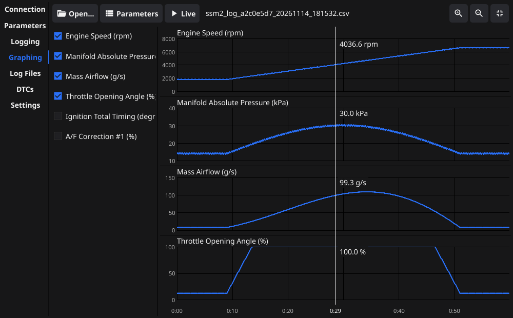

<p align="center">
  
</p>

# ecLogger

A cross-platform desktop app for logging, graphing and diagnosing Subaru ECUs over the SSM2 protocol.

Plug in a serial cable, pick the parameters you care about, and watch them live, log them to CSV, and graph a log afterwards. It's built to run just as well on a laptop as on a Raspberry Pi touchscreen mounted in the car.



## Features

- **Live logging.** Choose from hundreds of ECU parameters, plus derived ones such as boost, and see their current, min and max values on live tiles.
- **Log to file.** Record any set of parameters to CSV. Log file names are templated, so each log can be named by ROM ID and timestamp.
- **Graphing.** Chart parameters as stacked lanes on a shared time axis, either live while connected or from any saved log. Zoom, pan, and hover (or tap) to read every lane's value at that moment.
- **Log files.** Browse, graph and delete your logs without leaving the app.
- **Unit conversion.** Pick the unit for each parameter (psi, kPa, bar, °F, °C, mph, km/h, …) and it's used on screen and in your logs.
- **Trouble codes.** Read the set and stored DTCs from the ECU.
- **Remembers your setup.** Selected parameters, units, port and settings are saved between runs. It can connect automatically on start and open straight to the Logging tab.
- **A CLI too.** `ssm2-cli` does headless logging, handy for scripting or a Pi without a screen.


## Getting started

### What you need

- A Subaru with an SSM2-compatible ECU.
- A cable that exposes the ECU's diagnostic line as a serial port on your computer.

### Install

Download the latest build from [GitHub Releases](https://github.com/gavinwade12/ecLogger/releases). Pick the asset for your computer:

| Computer | App | CLI |
| --- | --- | --- |
| Mac (Apple silicon or Intel) | `logger-ui_<version>_darwin_universal.zip` | `ssm2-cli_<version>_darwin_universal.zip` |
| Windows | `logger-ui_<version>_windows_amd64.zip` | `ssm2-cli_<version>_windows_amd64.zip` |
| Linux PC | `logger-ui_<version>_linux_amd64.tar.xz` | `ssm2-cli_<version>_linux_amd64.tar.gz` |
| Raspberry Pi (64-bit Raspberry Pi OS) | `logger-ui_<version>_linux_arm64.tar.xz` | `ssm2-cli_<version>_linux_arm64.tar.gz` |

The Raspberry Pi build needs the 64-bit Raspberry Pi OS; there's no 32-bit build.

The builds aren't signed by Apple or Microsoft, so the first time you open the app your OS will push back:

- **macOS** says it can't check the app for malicious software. Unzip it, move `Logger.app` to Applications and try to open it once, then go to *System Settings → Privacy & Security* and click *Open Anyway*. Or clear the quarantine flag before opening it:

  ```sh
  xattr -dr com.apple.quarantine /Applications/Logger.app
  ```

- **Windows** SmartScreen says it protected your PC. Click *More info*, then *Run anyway*.

On **Linux and the Pi**, unpack the archive and install it for your user (or with `sudo make install` for everyone):

```sh
tar -xJf logger-ui_<version>_linux_arm64.tar.xz
cd logger-ui && make user-install
```

Then give yourself access to serial ports by joining the `dialout` group, and log out and back in for it to take effect:

```sh
sudo usermod -aG dialout $USER
```

#### Verify a download

Each release has a `checksums.txt` of every asset, signed with [minisign](https://jedisct1.github.io/minisign/). Download it and `checksums.txt.minisig` next to your assets, check the signature, then check the assets against it:

```sh
minisign -Vm checksums.txt -P RWS9Uq8XH1vJcNvTwOom+Y1lI6UJli9iEUp7HZ6DQu5dIkRQX6dmsAhE

shasum -a 256 -c checksums.txt --ignore-missing     # macOS
sha256sum -c checksums.txt --ignore-missing         # Linux
```

### Build from source

You'll need [Go](https://go.dev/dl/) 1.25 or newer. ecLogger's UI uses [Fyne](https://fyne.io/), so first install its [prerequisites](https://developer.fyne.io/started/#prerequisites) for your OS (mostly a C compiler and some graphics headers). On Debian, Ubuntu and Raspberry Pi OS, also install `libwayland-dev`, which the windowing library needs to build, even if you only use X11. Then:

```sh
git clone https://github.com/gavinwade12/ecLogger.git
cd ecLogger

go build -o cmd/logger-ui/logger-ui ./cmd/logger-ui
go build -o cmd/ssm2-cli/ssm2-cli ./cmd/ssm2-cli
```

### Use it

1. Open the app (or run `cmd/logger-ui/logger-ui` if you built it).
2. On the **Connection** tab, pick your serial port and connect.
3. On **Parameters**, tick *Live Log* for what you want to watch and *Log To File* for what you want to record.
4. Open **Logging** for live tiles and to start and stop a log file, or **Graphing** to chart values as they arrive.
5. Come back to **Log Files** to graph or delete past logs.

Settings and logs live in your home directory by default; the log folder and file name format can be changed in **Settings**.

### Try it without a car

A dev build adds a *Use Fake Connection* switch in Settings that feeds the app made-up data. It's good for poking around or working on the UI.

```sh
go build -tags dev -o cmd/logger-ui/logger-ui ./cmd/logger-ui
```

## Command line

```sh
ssm2-cli ports list                       # find your serial port
ssm2-cli ports set                        # save the port to use
ssm2-cli add_param --paramID <id> --unit <unit>
ssm2-cli log                              # log the configured parameters
```

Run `ssm2-cli --help` for everything else.

## Project layout

| Path | What's there |
| --- | --- |
| `cmd/logger-ui` | The Fyne desktop app |
| `cmd/ssm2-cli` | The command-line logger |
| `protocols/ssm2` | The SSM2 protocol: packets, parameters, DTCs, and the connection |
| `internal/logging` | Logging sessions, CSV reading and writing, and chart data |
| `internal/serialport` | Serial port access |
| `units` | Unit definitions and conversions |

Tests run with `go test ./...`.

## Releasing

Pushing a `v*` tag (`v0.2.0-rc.1` makes a prerelease) runs the release workflow, which builds every archive and attaches them and `checksums.txt` to a draft release. Then:

```sh
scripts/sign-release.sh v0.1.0
```

It downloads the draft's assets, checks them against `checksums.txt`, signs it with minisign, uploads the signature and, once you confirm, publishes the release. It needs `gh` and `minisign` (`brew install gh minisign`), and uses the secret key at `~/.minisign/minisign.key` unless `MINISIGN_KEY` says otherwise.

## Safety

ecLogger only reads from the ECU. Even so, it's a hobby project that comes with no warranty: don't watch the screen instead of the road, and make sure a passenger or a mounted display is doing the looking when you're moving.

## Why

Subarus, programming, data, and something new to learn. Also, a few seconds of warning before my WRX blows up would be nice, and it gave me a reason to finally buy a touchscreen for my Raspberry Pi.

## License

[BSD 3-Clause](LICENSE)
